# AI Animation Styles: one scene, 10 styles

**عربي ↓** · English below

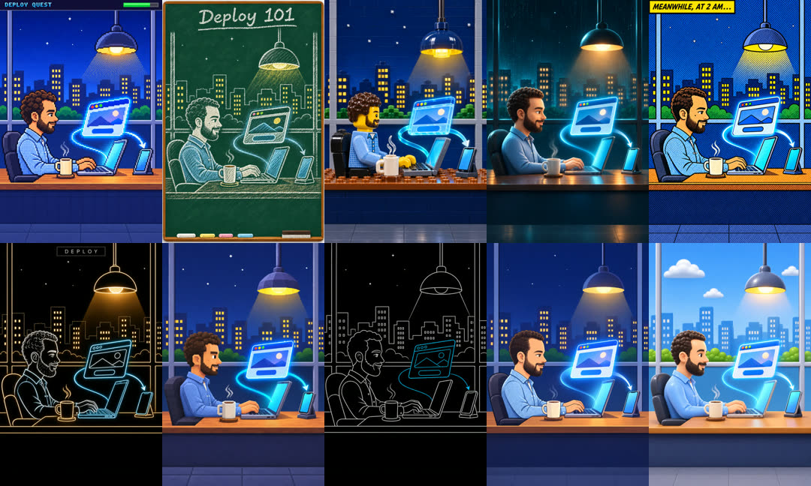

## بالعربي

صورة وحدة إلك، و3 prompts، وبيطلعلك نفس المشهد بعشر ستايلات متحركة: Pixel, Chalkboard, Lego, CGI, Comic, Glow, PS2, Minimal, Flat, 3D.

1. **الصورة الأساسية:** حط صورتك بـChatGPT (أو أي موديل صور) مع [الـprompt الأول](#step-1-the-master-image). بيرسمك كرتون بنفس المشهد.
2. **الستايل:** حط الصورة اللي طلعت مع [prompt الستايل](#step-2-restyle-it) واختار واحد من [الستايلات العشرة](#the-10-styles). نفس المشهد، نفس الشخص، ستايل جديد.
3. **الحركة:** حط كل صورة بموديل image-to-video (Kling، Hailuo، Higgsfield، أو Wan وLTX ببلاش على [RunPod](https://github.com/alihaidar2950/wan-setup)) مع [prompt الحركة](#step-3-animate-it).

غيّر سطر الـScene بالـprompt الأول لمشهدك إنت، والباقي بيمشي متل ما هو.

بدك Claude يكتبلك الـprompts كلها (الصورة، الستايلات العشرة، والفيديو) لمشهدك إنت؟ في [prompt جاهز لـClaude](#let-claude-write-the-prompts-for-your-own-scene).

الـprompts انكتبت مع Claude. الصور: GPT Image 2. الحركة: MiniMax H3.

---

## English

One photo of you and three prompts give you the same scene in 10 animated styles. Every image is a restyle of one master image, so the layout matches from style to style, and that's what makes the side-by-side work.

### Step 1: the master image

Attach a clear photo of yourself to ChatGPT (GPT Image 2) or any image model, then paste:

```text
Create a vertical 9:16 image (1024x1536). Polished flat-vector cartoon illustration with a premium
explainer-video finish: clean vector shapes, soft gradients, dark navy night sky, warm lamp glow,
crisp shading.
Scene: side view, facing right, of the person in the attached photo, turned into a friendly cartoon
character that clearly resembles them (keep their hair, beard, eye colour, glasses or no glasses, and
clothes). They sit at a wooden desk at night, both hands on the keyboard of an open laptop, about to
press Enter. Behind them a large window shows a night city skyline with warm lit windows and a few
stars. A smartphone on a small stand on the right of the desk. A glowing blue website card (a browser
window with a hero image and a button) floats up out of the laptop on a soft blue light trail,
arcing toward the phone. A coffee mug on the desk.
Composition: character and desk in the middle third, a horizontal desk line across the frame,
skyline behind, a darker floor strip at the bottom, generous sky at the top.
No text, no logos, no watermark.
```

To make it your own scene, rewrite only the `Scene:` lines and keep the rest. One person, one clear action and one bright object works best, because that's what reads in every style.

### Step 2: restyle it

Attach the master image, paste this, and replace `{STYLE}` with one of the 10 styles below:

```text
Redraw the attached image. Keep exactly the same composition, camera angle, layout, objects and their
positions, in this art style: {STYLE}
Keep the person recognisable as the same person. Vertical 9:16, 1024x1536.
No other text, no logos, no watermark.
```

Tip: if a style drifts, attach a second image that already has the look you want, and add "in the art style of the second image".

### Step 3: animate it

Put each styled image into an image-to-video model (4–5 s, 9:16) with:

```text
Static camera, the illustration style stays exactly the same as the image. The person types quickly
on the laptop keyboard, then presses Enter with a confident tap. The glowing blue website card lifts
out of the laptop and glides along the curved light trail into the phone on the stand, and the phone
screen lights up bright blue. They lean back slightly and smile. City window lights twinkle softly,
steam rises from the coffee mug. Smooth, clean animation, no new objects, no text changes.
```

If you changed the scene in step 1, describe your scene's one action here instead.

### Let Claude write the prompts for your own scene

These prompts were written with Claude. To get a full set for **your** scene (the master image, the 10 styles and the video prompt), paste this into [Claude](https://claude.ai) and fill in the first line:

```text
My scene: [who you are, where you are, the ONE action that happens, the ONE bright object that moves].

You write prompts for AI image and video models. I want this scene drawn as one cartoon master image
from a photo of me, then redrawn in 10 animation styles, then each one animated. Write, each in its
own plain-text code block:

1. MASTER IMAGE (GPT Image 2 or any image model, my photo attached): vertical 9:16, 1024x1536,
   polished flat-vector cartoon with a premium explainer-video finish; side view of the person in
   the attached photo turned into a cartoon that clearly resembles them (hair, beard, glasses or not,
   clothes); my scene with its one action about to happen and its one bright object; composition:
   subject in the middle third, a horizontal ground or desk line, a background layer, a darker strip
   at the bottom; no text, no logos, no watermark.
2. RESTYLE: one prompt that redraws an attached image keeping exactly the same composition, camera
   angle, layout, objects and positions, changing only the art style, with a {STYLE} slot, and
   keeping the person recognisable.
3. TEN {STYLE} LINES, one each for: Pixel, Chalkboard, Lego, CGI, Comic, Glow, PS2, Minimal, Flat,
   3D. Each line names the medium, the texture, the palette and one small on-screen detail (a title,
   a HUD, a caption box) that fits my scene.
4. VIDEO (image-to-video, 4-5 s, 9:16): static camera; the style stays exactly as the image; my one
   action plays from start to finish and the bright object moves along a clear path; two small
   ambient motions (lights, steam, clouds); no new objects, no text changes.

Keep every prompt under 120 words, in English, ready to paste.
```

Then run steps 1–3 above with what Claude gives you.

## The 10 styles

Paste the line under each style in place of `{STYLE}`.

### Pixel

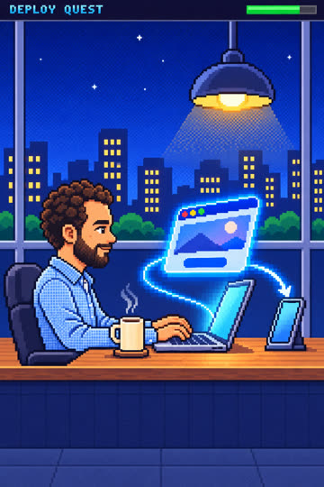

```text
Pixel Art: 16-bit retro video game, crisp square pixels, limited palette, a dark HUD bar across the top with the text "DEPLOY QUEST" on the left and a green XP bar on the right.
```

### Chalkboard

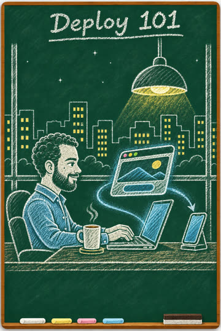

```text
Chalkboard Style: drawn in chalk on a dark green school chalkboard inside a wooden frame, white chalk lines with yellow, pink and blue chalk accents, smudgy chalk texture, the title "Deploy 101" handwritten at the top, chalk sticks on the bottom ledge.
```

### Lego

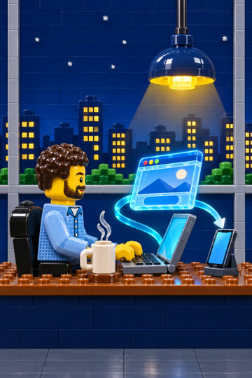

```text
Lego Style: the whole scene built from LEGO bricks and photographed like a glossy macro toy photo; the person is a LEGO minifigure with their hair piece, beard and clothes printed on; studs visible on the desk, buildings made of bricks, the website card a translucent blue LEGO tile.
```

### CGI

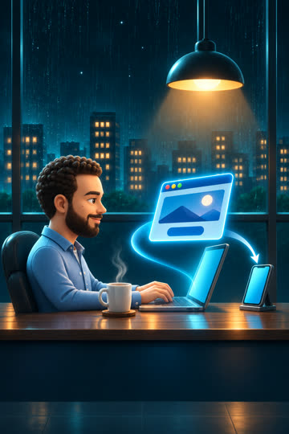

```text
CGI Motion: cinematic 3D animated-film render, moody teal and navy night, volumetric light from the lamp, glossy reflections on the desk, rain-streaked window, a stylised 3D character like a modern animated feature, shallow depth of field.
```

### Comic

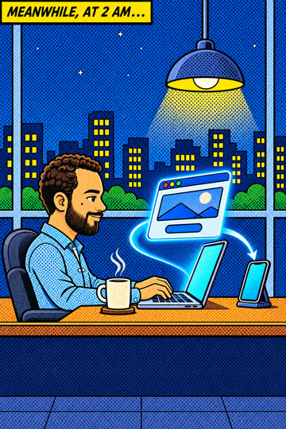

```text
Comic Art: pop-art comic book panel, bold black ink outlines, saturated flat colours, Ben-Day halftone dots in the sky and shadows, a yellow caption box at the top-left reading exactly "MEANWHILE, AT 2 AM..." in comic lettering.
```

### Glow

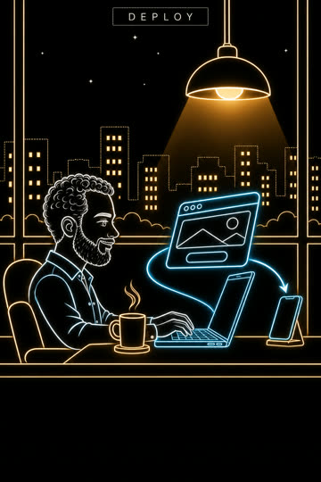

```text
Glow Sketch: pure black background, everything drawn as thin glowing neon outline line-art with soft bloom; city skyline, lamp and desk in warm amber-gold lines with a warm spotlight cone from the top, the person as a clean white glowing line drawing (keep their hair and beard in the line work), the website card and its trail glowing blue. A small thin-outlined sign box at the top centre reading exactly "DEPLOY" in spaced capitals.
```

### PS2

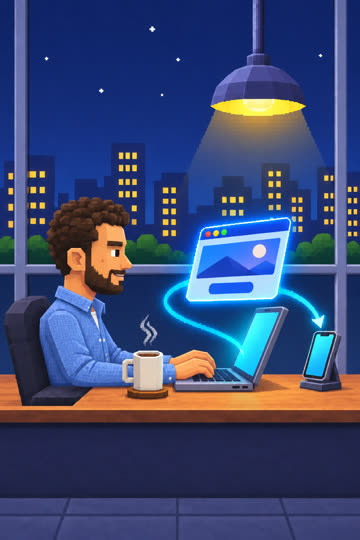

```text
PS2 Style: early-2000s PlayStation 2 game graphics, low-poly 3D models with blocky hands, low-resolution textures, simple vertex lighting, slightly jaggy edges, the character as a low-poly game model that still has their hair, beard and clothes.
```

### Minimal

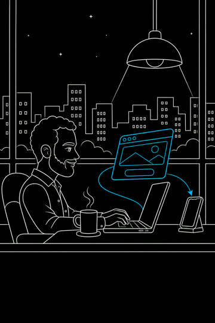

```text
Minimal Line: black background, thin single-weight white line drawing with very little detail, lots of empty space, only one colour accent: the website card and its trail in blue.
```

### Flat

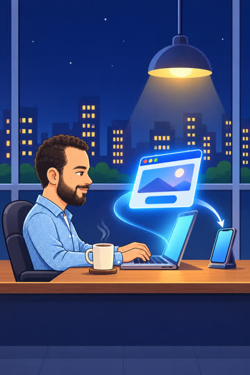

```text
Flat Vector: polished flat-vector cartoon illustration, clean vector shapes, soft gradients, crisp shading, dark navy night sky and warm lamp glow (this is the master image's own style, so you can also use the master as it is).
```

### 3D

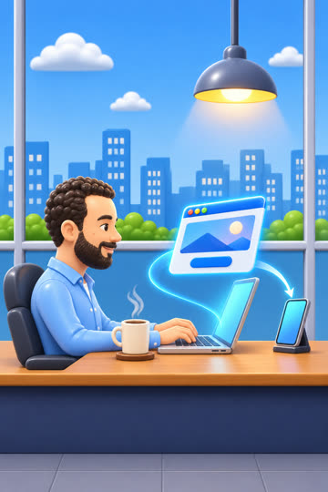

```text
Explainer 3D: bright, clean, glossy toy-like 3D render like a modern 3D explainer video, soft studio lighting, rounded shapes, a bright daytime blue sky with puffy clouds outside the window instead of night.
```

## Made with

- Prompts written with [Claude](https://claude.ai)
- Images: GPT Image 2 (through ChatGPT / Codex)
- Motion: MiniMax H3, image-to-video, on a rented RunPod GPU ([how to run open video models on RunPod](https://github.com/alihaidar2950/wan-setup))

By [@alihaidar.dev](https://www.instagram.com/alihaidar.dev/). Use the prompts however you like.
